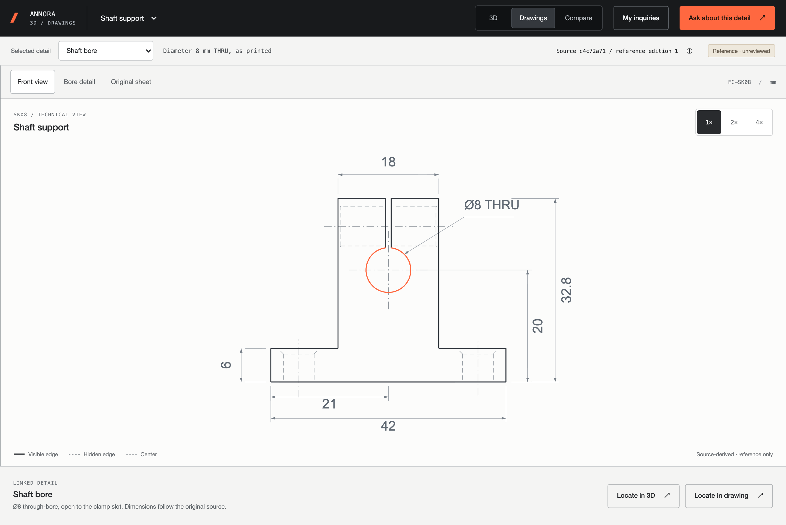
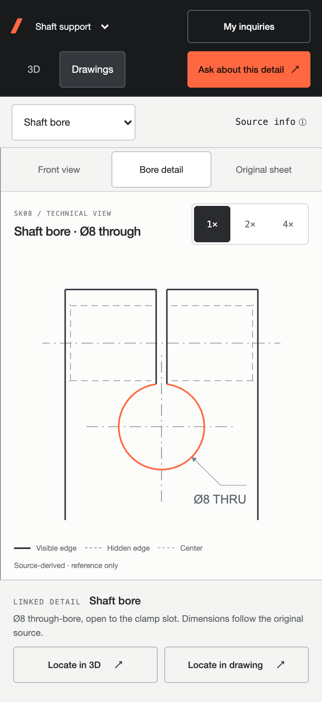

# SK08 technical reading preview

This records the initial front/bore release. The subsequent
[technical reading expansion](technical-reading-expansion-review.md) adds other
views, shared Studio/Product Room previews and per-feature association eligibility.

## Scope and reference lock

Build one source-derived front view and a shaft-bore detail for SK08. Keep the
original PDF available and preserve the canonical drawing references used by
inquiries, quotations and discussion history. No Explorer or Studio redesign.

The approved Annora drawing host is the primary reference: graphite chrome,
neutral paper, compact controls and Ember for active selection. The user's
Atlas reference contributes crisp geometry and restrained feature highlighting.
The [Factory design reference](https://factory.ai) contributes only compact,
flat controls and functional accent discipline; its marketing layout and type
scale do not belong in the drawing canvas.

| Decision | Basis | Application |
| --- | --- | --- |
| Geometry occupies the reading area | User's SK08 critique | Remove report headers and footnotes from the derived drawing canvas; keep context in the host. |
| Separate line roles | Source drawing and approved technical-view direction | Contour, hidden edges, centers and dimensions have separate neutral treatments. |
| Live vectors | Measured whole-page PDF raster limit at deep desktop zoom | Inline prepared SVG paths and text in the derived view; original reader stays unchanged. |
| Accurate selection | User's request for better selected feedback | Highlight the actual shaft-bore circle, retain an invisible touch target. |
| One source identity | Existing drawing revision contract | Presentation controls never substitute a derived asset for a canonical inquiry reference. |
| Explicit original switch | User's source fidelity requirement | Original PDF retains its colors, page layout and title block. |

This is a derived reading view, not a manufacturing release. It does not add
dimensions, tolerances, approvals or geometry to the source.

## Acceptance

- Front view and bore detail are readable at fit, 2× and 4×.
- Text, contour, hidden edges and center lines remain vector elements.
- Selection follows the bore circumference; inactive rectangular hotspots do
  not decorate the drawing. Keyboard and touch selection remain available.
- Original drawing switching preserves the selected canonical detail and exact
  model, drawing, mapping and source-asset revisions.
- New source versions and unverified mappings use their original reader;
  the prepared SK08 presentation must never masquerade as revision B.
- Desktop and 390 px mobile checks include pan, zoom, original switching,
  inquiry entry and return navigation. A 320 px check covers control overflow.
- Run repository verification and inspect the built GitHub Pages subpath.

## Review links

- [Front view](https://kyle-annora.github.io/annora-explorer/drawing-preview/?product=sk08&view=drawings&detail=shaft-bore&presentation=front)
- [Bore detail](https://kyle-annora.github.io/annora-explorer/drawing-preview/?product=sk08&view=drawings&detail=shaft-bore&presentation=bore)
- [Original sheet](https://kyle-annora.github.io/annora-explorer/drawing-preview/?product=sk08&view=drawings&detail=shaft-bore&presentation=source)

Select **Front view → Bore detail → Original sheet**. The 1× preset restores the
prepared composition; 2× and 4× center the selected bore. Drag to pan and pinch
to zoom. **Ask about this detail** still opens the existing reviewed inquiry.

## Implementation

The prepared SVG extracts 38 original PDF geometry paths, including the exact
open clamp slot. Existing source values are recomposed as neutral dimension
labels; no requirements are invented. See the [asset provenance and regeneration
checks](../content/drawings/sk08/technical-provenance.md).

The technical adapter reuses the existing reader's pointer, pinch and keyboard
controls. It inlines reviewed SVG paths and text, and highlights the two exact
bore contour paths. The shared reader adds an optional feature-centered zoom
method; its existing relative zoom, source PDF and Studio authoring behavior
remain unchanged. There is no new animation loop, CAD kernel or WebGL context.
The SVG is approximately 12 KB before compression. PDF.js still loads only when
a PDF reader is needed.

Eligibility requires the exact prepared model, drawing, mapping and source-file
identities. Imported revision B and changed associations continue to use their
original reader. A source-specific presentation is never substituted by product
name alone. The original PDFs, STEP, model packages and saved business records
are unchanged.

## Validation — November 1, 2026

| Check | Result |
| --- | --- |
| Full repository verification | 509 tests: 508 passed, one existing conditional skip; validation and production build passed. |
| Desktop and mobile rendering | Front and bore at 1×, 2× and 4×; 1440, 390 and 320 CSS-pixel widths, DPR 2. |
| Vector sharpness | No image or canvas nodes in the technical artwork; selected contour stays at 2 CSS pixels. |
| Preset composition | 2×/4× center the selected bore; 1× restores fit after pan. |
| Touch and accessibility | At least 44 px feature target, tap and keyboard selection; dragging does not trigger selection. |
| Presentation navigation | Front/bore/source, unsupported-feature fallback, rapid switching, Back/Forward and inquiry return passed. |
| Reference integrity | Technical-mode inquiry keeps canonical source, sheet, detail, model and mapping identities; review and confirmation remain required. |
| Historical sources | Valid A and B plus eight invalid pinned-reference/reload cases passed; original file hashes are unchanged. |
| Built deployment path | Tested through `/annora-explorer/` at desktop and mobile sizes; no page errors or failed asset responses. |
| Existing Explorer | No changes to `src/explorer/`; its existing regression suite passed. |

Browser checks use Chromium on the development Mac, with mobile viewport/touch
emulation. They are not measurements from a physical phone or a low-end PC.
The original PDF reader's deep-zoom pixel budget is unchanged; the new technical
views avoid that raster limit by rendering vectors directly.
