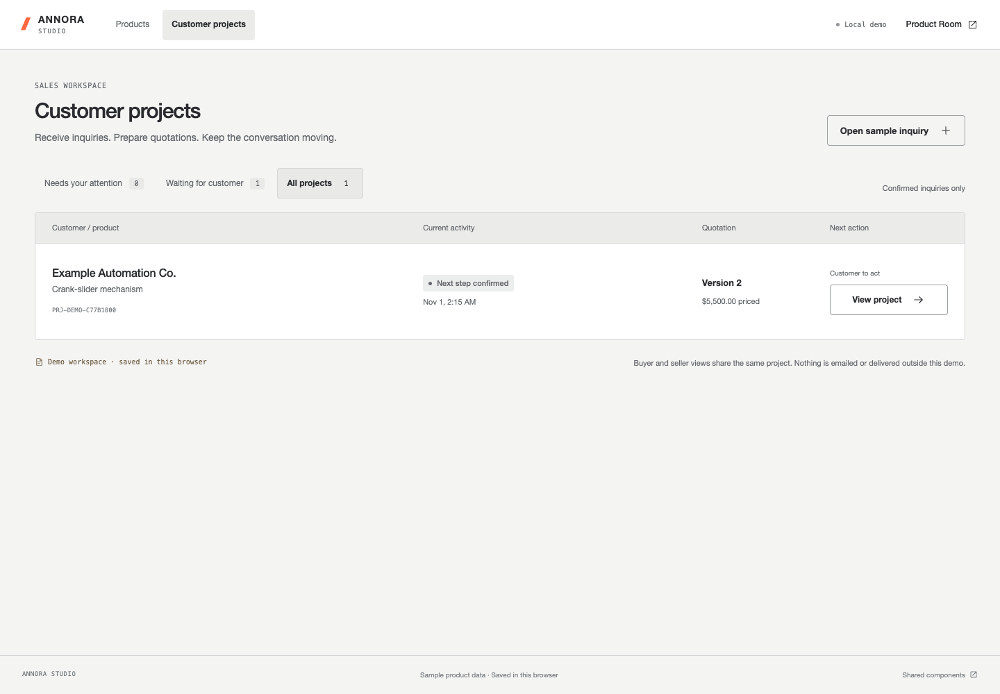
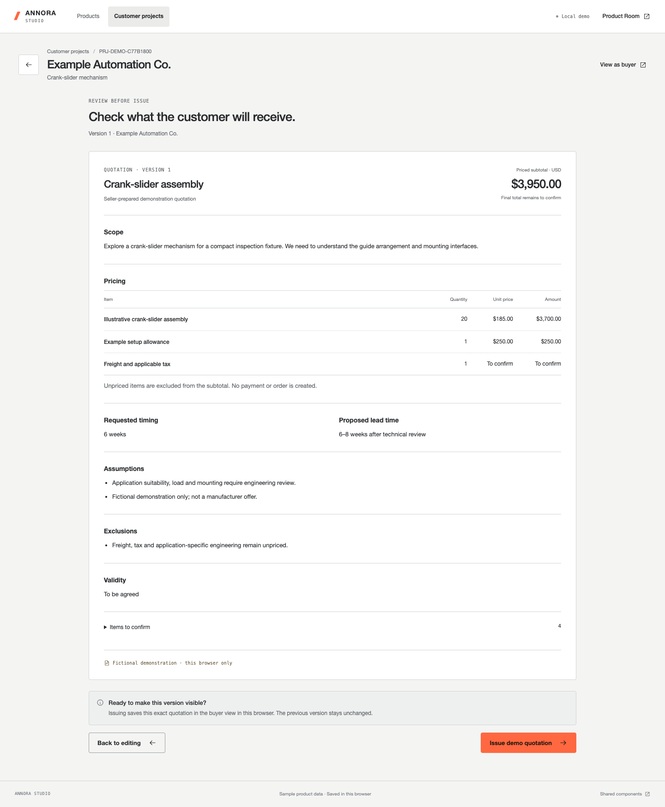
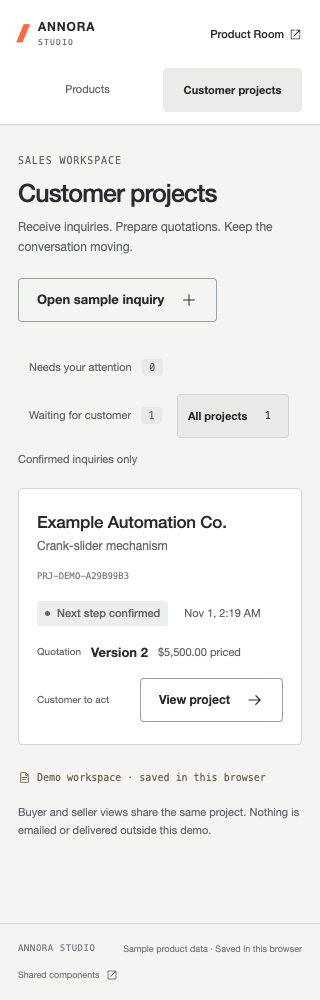

# Studio customer projects — release review

Reviewed November 1, 2026. Public demonstration content only.

## Review entry

[Open Customer projects](https://kyle-annora.github.io/annora-explorer/studio/#projects).
Choose **Open sample inquiry** for a quick seller start, or submit a fictional
inquiry through [Product Room](https://kyle-annora.github.io/annora-explorer/product-room/#inquiry).
Use **View as buyer / View as seller** to inspect the same local project.

Follow the [complete walkthrough](studio-customer-projects.md). Project links
resolve browser-local records; the public entry above works on a fresh browser,
but does not transfer another browser's saved project data.

## Delivered

- Products and Customer projects are distinct Studio destinations.
- Seller queue identifies the customer, quotation version and next-action owner.
- Seller quotation drafts remain separate from issued buyer-visible versions.
- Review and explicit confirmation precede quotation issuance and replies.
- Clarification does not create a new quote; modified terms produce immutable v2.
- Responses to requested changes can be saved with a quotation draft.
- Buyer comparison prioritizes changed fields, with unchanged fields available.
- Seller acknowledgement completes the demonstration's next-step loop.
- Product/model/document snapshots and legacy sample history remain preserved.
- Existing Explorer files and prepared model packages are unchanged.

## Recorded validation

`npm run verify`: **387 tests, 386 passed, 1 conditional skip, zero failures**.
The skip is the existing Studio unavailable-model case, which does not apply
when the prepared crank model is configured. Eighteen new seller-domain tests
cover the shared commercial workflow and migration boundaries.

Browser review used Chromium on this Mac, including built files served beneath
`/annora-explorer/`, matching the GitHub Pages subpath.

| Check | Observed result |
| --- | --- |
| Buyer → seller → buyer | Inquiry, draft, review/issue v1, change request, clarification/reply, v2, comparison, engineering-review request and seller acknowledgement completed |
| Draft privacy in UI | Buyer case remained awaiting a quote while seller draft was saved |
| Review boundary | Review alone wrote no issued quotation; explicit issue appended one immutable version |
| Original history | v1 and the original inquiry remained identical after v2 |
| Legacy migration | Read alone left schema-v1 storage unchanged; new sample creation preserved original project fields |
| Failed write | Input stayed visible and no successful receipt or storage write appeared; restoring storage allowed save and reload |
| Cross-tab conflict | Stale save was rejected; local unsaved text and other tab's saved values both survived |
| Navigation | Unsaved quote/reply reviews offered a keep-editing path |
| Product independence | Existing customer cases remained accessible with an unreadable separate product-content store |
| Historical 3D | Saved project opened one unchanged Explorer and its rod context using a snapshot absent from Studio's release registry; reload preserved it |
| Missing reference | Missing project failed visibly without loading a fallback model |
| Mobile | Full buyer/seller journey at 320 px without horizontal overflow; 390 px recovery and product-authoring checks |
| Loading | Direct queue/editor/customer-project journey requested no model geometry files |

These checks do not measure physical-phone behavior, entry-level GPU frame rate,
production concurrency, real message delivery or authentication. The adapter is
browser-local and the backend boundary remains documented, not implemented.

## Visual evidence

