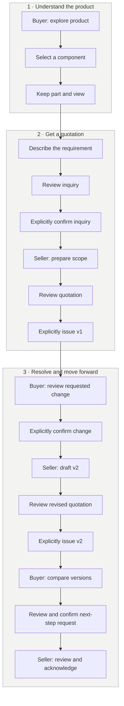
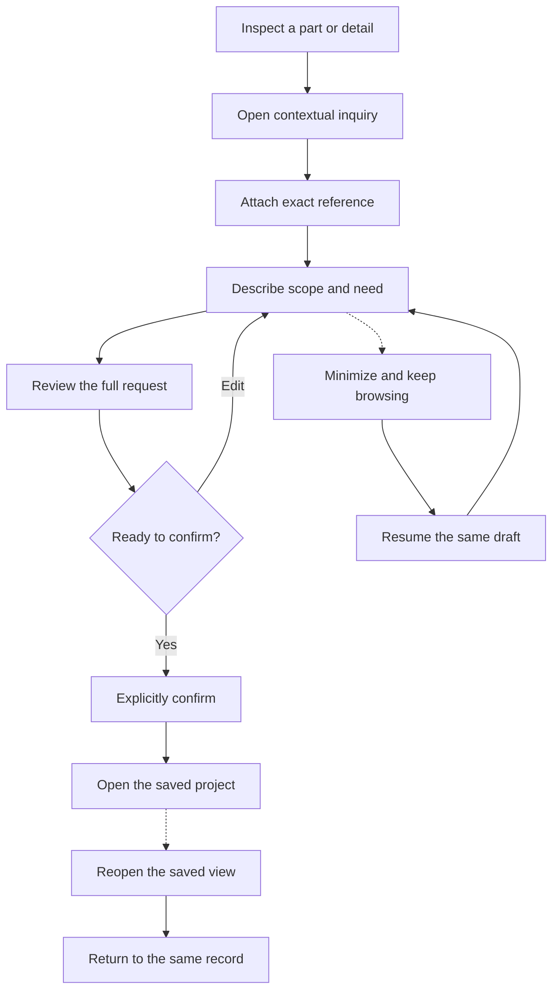
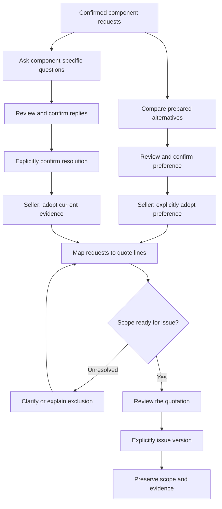
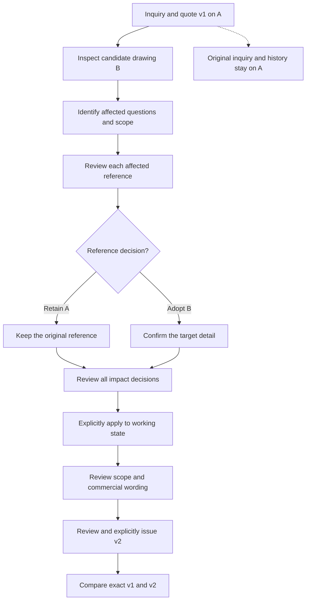
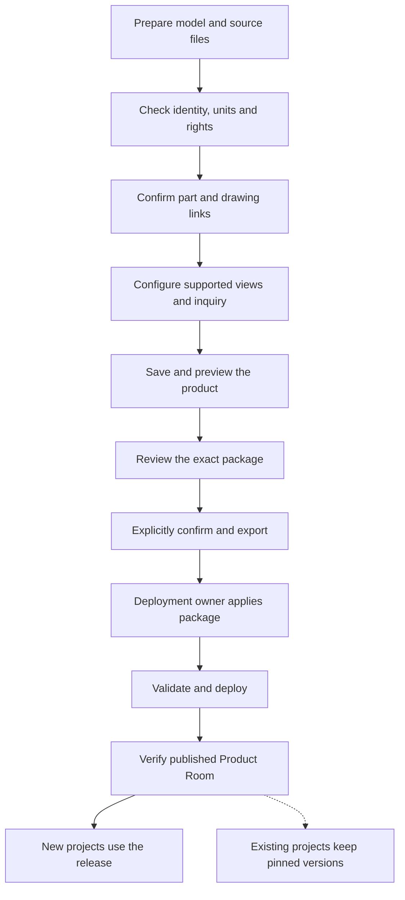
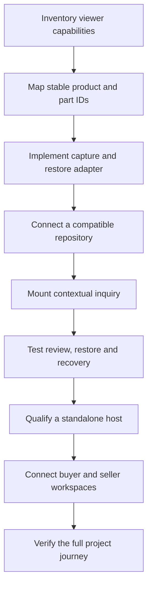

# Annora user workflow maps

Review edition · November 7, 2026

[Open the visual workflow guide](https://kyle-annora.github.io/annora-explorer/workflows/).

Annora connects product understanding to a specific inquiry, a reviewed quotation
and an agreed next step. The same project carries the selected part, saved view
and applicable document versions between buyer and seller.

Use Map 1 on a customer call. Use Maps 2–5 to explain a relevant branch. Map 6 is
for the customer's integration team. These are supported demo paths, not evidence
of observed customer behavior or measured conversion improvement.

[Open the independent-viewer walkthrough](https://kyle-annora.github.io/annora-explorer/walkthrough/?viewer=independent).

## People and workspaces

| Person | Goal | Workspace |
| --- | --- | --- |
| Buyer or application engineer | Understand a product, identify a requirement and request a useful response | Existing viewer or Explorer; contextual inquiry; Product Room |
| Returning buyer | Reopen the exact reference, answer questions, compare quotations and agree on the next action | Saved project or a focused follow-up |
| Sales or application engineer | Clarify requests, define offered scope, issue a reviewed quote and respond to changes | Studio customer projects |
| Product owner | Prepare and maintain product content, part associations, technical views and inquiry configuration | Studio product editor and intake workflow |
| Integration developer | Connect the customer's viewer and persistence to the supported workflow | Integration kit and host adapters |
| Patrick or Wesley | Explain the commercial value through one clear path | Three-chapter walkthrough with Continue demo |

Product Room is the buyer workspace. Studio contains both product publishing and
seller project work. Explorer supplies product understanding. An independent
viewer can supply supported viewing capabilities through an adapter instead.

## 1. From product understanding to an agreed next step

**Question answered:** How does a product detail become a commercial conversation?

This is the selected demonstration scenario. A real project does not need a
revision before agreeing on a next step. The illustrated endpoint is an
acknowledged engineering discussion, not an order, payment or signed agreement.
All confirmations in this demo create browser-local sample records.

**What travels:** project identity, requested component, original saved view,
product/model versions, inquiry, quotation versions and the associated discussion.
Opening a historical quote restores its own reference, not today's latest view.

Source: [independent-viewer walkthrough review](w60-integration-walkthrough-review.md)
and [acceptance matrix](w60-integration-walkthrough-acceptance.md).

## 2. Turn a specific detail into an inquiry

**Question answered:** Can a buyer ask about the thing they are looking at without
losing their place?

The attached reference does not change just because the buyer browses another
part. Replacing it requires an explicit action. A failed save retains the input
for retry; changing reviewed input requires another review.

There are two supported entry variants:

- **Native Explorer / prepared Product Room:** part selection, saved inspection
  or a published technical-story step; drawing details require a product with
  confirmed drawing associations. Multiple request items can describe distinct
  components within a supported project.
- **Qualified independent viewer:** selected component and exact camera. The
  current independent example does not implement drawings, mechanism animation
  or guided-story playback; those are capability-specific adapter work.

Source: [exploration-to-quote review](exploration-to-quote-review.md),
[integration review](w50-integration-kit-review.md) and
[prepared-product review](w40-prepared-product-review.md).

## 3. Convert preferences and questions into offered scope

**Question answered:** How does the seller know what the buyer wants and explain
what is actually included?

These are optional branches, not mandatory steps for every inquiry. They have
separate qualified examples; the short independent-viewer walkthrough does not
run every branch.

- The current alternatives are two prepared support packages around the same
  crank. They do not reconfigure geometry or calculate prices automatically.
- Each question has its own identity, reference, replies and resolution. An
  answer does not automatically resolve a question. Only the relevant blocking
  questions and incomplete scope prevent issue.
- Informational questions may remain open. Unresolved scope-affecting questions
  block quotation issue and next-step confirmation; changing a drawing link does
  not resolve the question itself.
- A request can map to more than one quotation line. New buyer preferences or
  later question evidence do not silently update an existing quotation draft.
- Issued quotes freeze the selected preference, scope and applicable evidence.
  Later changes are adopted deliberately into a new draft and issued version.

Source: [option/scope review](option-scope-review.md) and
[question workflow review](questions-review.md).

## 4. Review a drawing change without rewriting history

**Question answered:** What happens when the product reference changes after an
inquiry or quotation?

Uncertain or missing associations require resolution; they are not automatic
matches. Different items can deliberately retain different versions. Applying
impact decisions does not issue a quote or rewrite commercial terms. The seller
must review the resulting customer-facing quotation separately.

For quotation request scope, an explicit omission with an explanation is also
available. A question cannot be omitted through this decision. Impact review
currently covers questions and quotation request scope; presentation and follow-up
impact are deferred.

The SK08 A→B example demonstrates a changed document layout and review note, not
a validated manufacturing-design change. This flow tracks reference impact; it
does not certify engineering equivalence.

Source: [drawing impact review](drawing-impact-review.md) and
[drawing association workflow](studio-drawing-workspace.md).

## 5. Prepare and publish a product

**Question answered:** How can a seller bring another product into the experience?

This map describes the verified new-product intake path. The NEMA 17 bracket
proves a new prepared product can be registered without editing shared runtime
JavaScript. Source qualification, offline CAD conversion and authored technical
compositions still require preparation. Arbitrary CAD upload does not produce a
finished experience automatically.

Existing product editing and overview authoring use draft, preview, review and
local release states in Studio. A browser-local release is distinct from public
deployment. New-product intake exports a reviewed package for the deployment
owner; the Studio confirmation alone does not update the public website.

Source: [product onboarding review](w41-product-onboarding-review.md),
[operator workflow](product-onboarding.md) and
[overview authoring](studio-overview-authoring.md).

## 6. Connect an existing viewer

**Question answered:** What does the customer's technical team need to integrate?

The customer keeps ownership of rendering, camera and selection. Annora receives
an exact, versioned reference through the adapter. Unsupported operations or
missing historical models must fail clearly instead of substituting a different
view or version.

Integration kit 0.2.0 proves installation into one independent viewer. Its optional
walkthrough adapter currently joins same-origin static Product Room and Studio
pages. The inquiry-only host is independently installable; the optional module is
not a complete portable seller application. Every additional viewer requires its
own adapter qualification.

Source: [integration guide](integration-kit.md),
[API contract](integration-kit-api.md) and
[independent-viewer walkthrough review](w60-integration-walkthrough-review.md).

## Returning users and focused follow-up

A returning buyer can reopen a saved project, continue a draft, inspect a specific
quotation, answer an open question or request a next step. The saved reference
returns them to the correct product version and back to the originating record.
Browser-local return is implemented; account-based cross-device return is not.

For a focused follow-up, the seller selects relevant released story steps or
compatible saved views, links them to existing requests, and chooses one exact
quote or question as the next action. The seller previews, reviews and confirms
the follow-up. The buyer can pause, explore, resume and continue to that target.
Old follow-up versions remain available. Authoring another local version does
not create a private share link for another browser.

Source: [customer follow-up review](customer-follow-up-review.md).

## Presenting the maps

For a first call, use Map 1 and the three chapters. Show Maps 2 and 6 when the
customer already has a viewer; show Maps 3 and 4 when scope clarification or
document revisions are the more important problem. Use Map 5 with the person who
will maintain product content.

The presentation overlay provides one **Continue demo** action and an explicit
buyer/seller label. At a review boundary, a later **Confirm & continue** action
commits the reviewed sample record. This presentation guidance does not replace
the underlying user's choices or introduce automatic approval.

Useful customer questions:

1. Where do buyers lose context between inspecting a product and asking for help?
2. What must accompany an inquiry before your team can quote responsibly?
3. Which changes most often force your team to revisit a quotation?
4. Who confirms scope, document references and the next commercial action?
5. Which viewer and systems would own identity, files and project persistence?

## Current boundary

The maps summarize released demo behavior and the existing integration contract.
The current deployment uses fictional, browser-local data. Authentication,
permissions, real delivery, notifications and cross-device storage need production
services. Automated pricing, payment and order placement are outside this demo.
The current evidence does not establish customer adoption or conversion gains.

This review edition adds documentation only. It does not change or republish
Explorer, Product Room, Studio, stored projects or the walkthrough.
